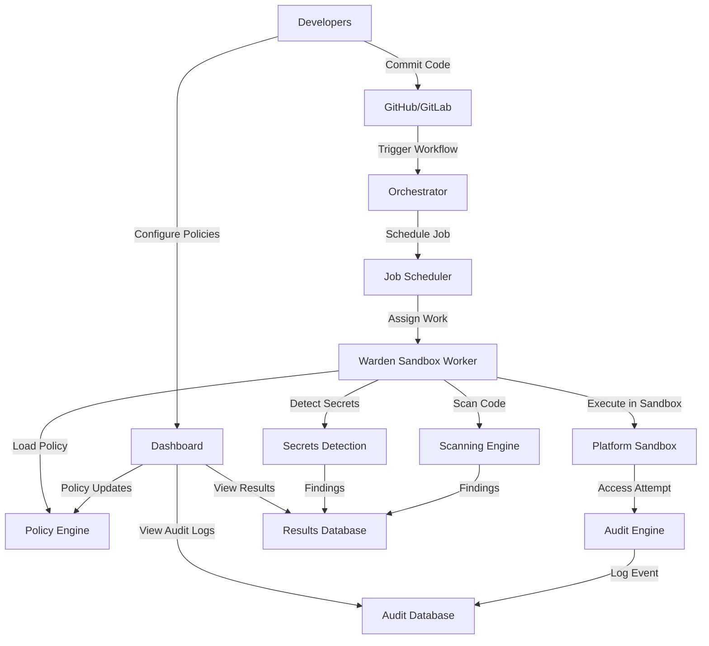
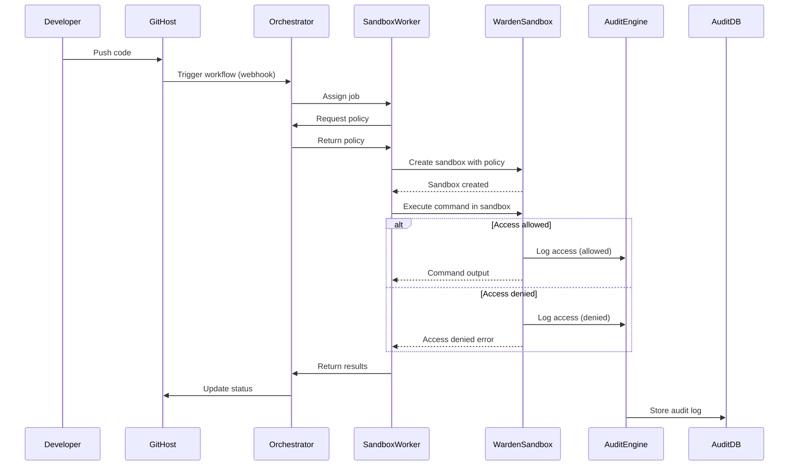
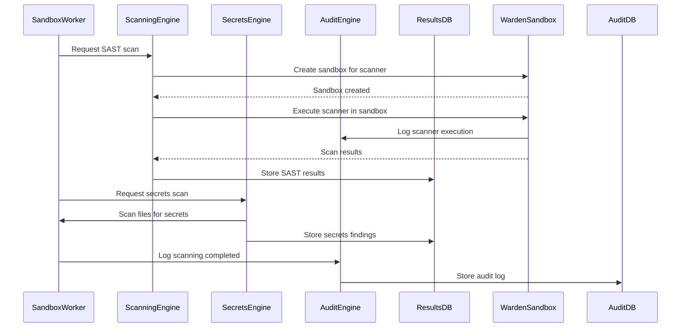
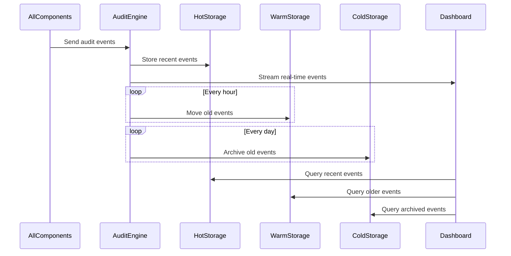

# Warden CI/CD - Technical Architecture

## Table of Contents
1. [Product Overview](#overview)
2. [Architecture Principles](#principles)
3. [System Architecture](#architecture)
4. [Core Components](#components)
5. [Integration Points](#integration)
6. [Security Model](#security)
7. [Data Flow](#data-flow)
8. [Deployment Models](#deployment)
9. [Performance Considerations](#performance)
10. [Scalability Design](#scalability)

---

## <a name="overview"></a>1. Product Overview

### 1.1 Product Vision
**Warden CI/CD** is a revolutionary CI/CD security platform that uses **Warden's zero-trust sandboxing** as its core to provide **end-to-end protection** against:
- Supply chain attacks
- Compromised developer laptops
- Malicious code execution
- Secrets leakage
- Unauthorized access

### 1.2 Key Differentiators

| Feature | Warden CI/CD | Traditional Solutions |
|---------|--------------|----------------------|
| **Runtime Sandboxing** | ✅ Deny-by-default | ❌ No sandboxing |
| **Zero-Trust Execution** | ✅ Every access checked | ❌ Trust-first model |
| **Pipeline Isolation** | ✅ Entire pipeline isolated | ❌ Task-level only |
| **Developer Laptop Protection** | ✅ Isolates developer access | ❌ No protection |
| **Multi-Platform** | ✅ Linux, macOS, Windows, Docker | ❌ Platform-specific |
| **Open Source Core** | ✅ Transparent, auditable | ❌ Closed source |

### 1.3 Value Proposition

**For Developers:**
- ✅ **Peace of mind**: Code runs in isolated, secure environments
- ✅ **No slowdowns**: Sandboxing happens transparently
- ✅ **Easy to use**: Simple configuration and management
- ✅ **Cross-platform**: Works on all major platforms

**For Security Teams:**
- ✅ **Comprehensive protection**: Addresses all major attack vectors
- ✅ **Audit trails**: Complete visibility into all access attempts
- ✅ **Compliance ready**: Meets SOC 2, ISO 27001, HIPAA, and more
- ✅ **Zero-trust model**: No implicit trust, everything verified

**For Organizations:**
- ✅ **Prevent breaches**: Stop attacks before they succeed
- ✅ **Reduce risk**: Protect against supply chain and credential attacks
- ✅ **Cost effective**: Lower TCO than multiple point solutions
- ✅ **Future-proof**: Open architecture, extensible platform

---

## <a name="principles"></a>2. Architecture Principles

### 2.1 Security Principles

1. **Deny by Default**
   - All access is **denied** unless explicitly allowed
   - No implicit trust, no exceptions
   - Every access attempt is logged and auditable

2. **Least Privilege**
   - Processes get **minimum required access**
   - Access is **temporary** and **revocable**
   - No standing privileges

3. **Zero Trust**
   - **Never trust, always verify**
   - Continuous verification of identity and access
   - Micro-segmentation and isolation

4. **Defense in Depth**
   - Multiple layers of security
   - No single point of failure
   - Redundant protections

5. **Fail Secure**
   - **Deny on failure**, not allow
   - Secure defaults
   - Graceful degradation

### 2.2 Design Principles

1. **Transparency**
   - Open source core (Warden)
   - Auditable code and processes
   - Clear documentation

2. **Developer-First**
   - Easy to use and configure
   - Minimal friction in workflows
   - Good developer experience

3. **Extensibility**
   - Plugin architecture
   - Custom rules and policies
   - Integration with existing tools

4. **Performance**
   - Minimal overhead
   - Parallel processing
   - Optimized for speed

5. **Reliability**
   - High availability
   - Fault tolerance
   - Self-healing

### 2.3 Operational Principles

1. **Observability**
   - Comprehensive logging
   - Real-time monitoring
   - Detailed metrics

2. **Automation**
   - Automated detection
   - Automated response
   - Automated remediation

3. **Scalability**
   - Horizontal scaling
   - Distributed architecture
   - Elastic resources

4. **Maintainability**
   - Clean code
   - Good documentation
   - Automated testing

---

## <a name="architecture"></a>3. System Architecture

### 3.1 High-Level Architecture

```
┌─────────────────────────────────────────────────────────────────────┐
│                           USER LAYER                                 │
│  ┌─────────────┐  ┌─────────────┐  ┌─────────────────────────────┐    │
│  │  Developer  │  │ Security    │  │     CI/CD Platform           │    │
│  │   Laptop    │  │   Team      │  │  (GitHub Actions, GitLab CI) │    │
│  └──────┬──────┘  └──────┬──────┘  └─────────────┬─────────────────┘    │
└─────────┼────────────────┼──────────────────────────┼─────────────────┘
          │                │                          │
          ▼                ▼                          ▼
┌─────────────────────────────────────────────────────────────────────┐
│                         CONTROL PLANE                                │
│  ┌─────────────────────────────────────────────────────────────────┐  │
│  │                        Warden CI/CD API                         │  │
│  │  ┌─────────────┐  ┌─────────────┐  ┌─────────────────────────────┐  │  │
│  │  │  Policy     │  │  Dashboard  │  │      Audit & Analytics      │  │  │
│  │  │  Engine     │  │   & UI      │  │        Engine                │  │  │
│  │  └─────────────┘  └─────────────┘  └─────────────────────────────┘  │  │
│  └─────────────────────────────────────────────────────────────────┘  │
│                                                                       │
│  ┌─────────────────────────────────────────────────────────────────┐  │
│  │                      Warden Orchestrator                         │  │
│  │  ┌─────────────┐  ┌─────────────┐  ┌─────────────────────────────┐  │  │
│  │  │  Job        │  │  Workflow   │  │      Integration            │  │  │
│  │  │  Scheduler  │  │   Engine    │  │        Manager               │  │  │
│  │  └─────────────┘  └─────────────┘  └─────────────────────────────┘  │  │
│  └─────────────────────────────────────────────────────────────────┘  │
└─────────────────────────────────────────────────────────────────────┘
          │                │                          │
          ▼                ▼                          ▼
┌─────────────────────────────────────────────────────────────────────┐
│                         DATA PLANE                                   │
│  ┌─────────────┐  ┌─────────────┐  ┌─────────────────────────────┐    │
│  │  Warden     │  │  Scanning   │  │      Secrets                │    │
│  │  Sandbox    │  │   Engine    │  │    Detection                │    │
│  │  Workers    │  │             │  │      Engine                 │    │
│  └──────┬──────┘  └──────┬──────┘  └─────────────┬─────────────────┘    │
│         │               │                        │                    │
│         ▼               ▼                        ▼                    │
│  ┌─────────────────────────────────────────────────────────────────┐    │
│  │                        EXECUTION ENVIRONMENT                    │    │
│  │  ┌─────────────────┐  ┌─────────────────┐  ┌─────────────────┐  │    │
│  │  │   Linux         │  │   macOS         │  │   Windows       │  │    │
│  │  │   Sandbox       │  │   Sandbox       │  │   Sandbox       │  │    │
│  │  │  (bubblewrap)   │  │  (Seatbelt)     │  │  (AppContainer) │  │    │
│  │  └─────────────────┘  └─────────────────┘  └─────────────────┘  │    │
│  └─────────────────────────────────────────────────────────────────┘    │
└─────────────────────────────────────────────────────────────────────┘
```

### 3.2 Architecture Layers

#### Layer 1: User Layer
- **Developers**: Write code, commit to repositories
- **Security Teams**: Configure policies, monitor security
- **CI/CD Platforms**: GitHub Actions, GitLab CI, Jenkins, etc.

#### Layer 2: Control Plane
- **API**: REST API for configuration and management
- **Policy Engine**: Manages and enforces security policies
- **Dashboard & UI**: Web interface for monitoring and management
- **Audit & Analytics Engine**: Collects and analyzes security data
- **Orchestrator**: Manages sandbox workers and job scheduling
- **Workflow Engine**: Orchestrates CI/CD workflows
- **Integration Manager**: Manages integrations with external systems

#### Layer 3: Data Plane
- **Warden Sandbox Workers**: Execute code in isolated sandboxes
- **Scanning Engine**: Performs SAST, SCA, and other security scans
- **Secrets Detection Engine**: Detects secrets in code and artifacts

#### Layer 4: Execution Environment
- **Platform-Specific Sandboxes**: OS-level sandboxing for Linux, macOS, Windows

### 3.3 Component Relationships



---

## <a name="components"></a>4. Core Components

### 4.1 Warden Sandbox Core (Existing)

**Purpose**: Provide OS-level sandboxing with deny-by-default access control.

**Capabilities**:
- Filesystem access control (read/write restrictions)
- Network access control (host allowlists/denylists)
- Process execution control (command restrictions)
- Environment variable filtering
- Resource limits (CPU, memory, time)
- Audit logging of all access attempts

**Platform Support**:
- **Linux**: bubblewrap (user namespaces)
- **macOS**: Seatbelt sandbox profiles
- **Windows**: AppContainer + WFP (Windows Filtering Platform)
- **Docker**: Container-based sandboxing (fallback)

**Integration**: Used as the foundation for all execution in Warden CI/CD.

---

### 4.2 Policy Engine

**Purpose**: Manage and enforce security policies for CI/CD workflows.

**Responsibilities**:
1. **Policy Parsing**: Parse policy YAML files
2. **Policy Validation**: Validate policies for syntax and semantics
3. **Policy Resolution**: Resolve relative paths, environment variables, etc.
4. **Policy Distribution**: Distribute policies to sandbox workers
5. **Policy Enforcement**: Enforce policies during execution
6. **Policy Versioning**: Manage multiple versions of policies

**Policy Types**:

```yaml
# Example: CI/CD Pipeline Policy
version: "1.0"
name: "production-deploy"
description: "Policy for production deployment pipeline"

# Global settings
settings:
  timeout: 3600  # 1 hour timeout
  memory_limit: 8GB
  cpu_limit: 4

# Filesystem access
filesystem:
  read:
    - "/workspace/src"
    - "/workspace/config"
  write:
    - "/workspace/artifacts"
    - "/workspace/logs"
  deny:
    - "/etc"
    - "/home"
    - "~/.ssh"
    - "~/.aws"

# Network access
network:
  allow:
    - "api.github.com"
    - "registry.npmjs.org"
    - "docker.io"
    - "*.company.com"
  deny:
    - "0.0.0.0/0"  # Deny all by default

# Environment variables
env:
  allow:
    - "GITHUB_TOKEN"
    - "NPM_TOKEN"
    - "CI"
    - "GITHUB_ACTIONS"
  deny:
    - "AWS_ACCESS_KEY_ID"
    - "AWS_SECRET_ACCESS_KEY"
    - "*_PASSWORD"
    - "*_SECRET"

# Process execution
process:
  allow:
    - "/usr/bin/node"
    - "/usr/bin/npm"
    - "/usr/bin/git"
    - "/usr/bin/docker"
  deny:
    - "/bin/bash"
    - "/bin/sh"
    - "curl"
    - "wget"

# Stage-specific policies
stages:
  build:
    filesystem:
      read:
        - "/workspace/src"
      write:
        - "/workspace/build"
    network:
      allow:
        - "registry.npmjs.org"

  test:
    filesystem:
      read:
        - "/workspace/src"
        - "/workspace/build"
    network:
      allow:
        - "api.github.com"

  deploy:
    filesystem:
      read:
        - "/workspace/artifacts"
    network:
      allow:
        - "api.github.com"
        - "production.company.com"

# Secrets detection
secrets:
  detection:
    enabled: true
    patterns:
      - "aws_access_key_id"
      - "aws_secret_access_key"
      - "github_token"
      - ".*password.*"
      - ".*secret.*"
  actions:
    on_detect:
      - "block"
      - "alert"
      - "redact"

# Scanning
scanning:
  sast:
    enabled: true
    tools:
      - "semgrep"
      - "codeql"
    severity_threshold: "high"
  
  sca:
    enabled: true
    databases:
      - "snyk"
      - "osv"
    ignore_dev: true

# Approval workflows
approvals:
  require_approval:
    - on_network_access: ["new_host"]
    - on_filesystem_access: ["sensitive_path"]
    - on_secret_detected: true
```

**Implementation**:
- Language: Go (for compatibility with Warden core)
- Storage: Policies stored in database with versioning
- Distribution: Policies cached at sandbox workers

---

### 4.3 Orchestrator

**Purpose**: Manage the execution of CI/CD workflows across sandbox workers.

**Responsibilities**:
1. **Workflow Parsing**: Parse CI/CD workflow YAML files
2. **Job Scheduling**: Schedule jobs across available workers
3. **Resource Allocation**: Allocate resources (CPU, memory, sandbox instances)
4. **Dependency Management**: Manage dependencies between jobs
5. **Error Handling**: Handle job failures and retries
6. **Status Tracking**: Track job status and progress

**Workflow Definition**:

```yaml
name: "Node.js CI"

on:
  push:
    branches: [ main ]
  pull_request:
    branches: [ main ]

jobs:
  build:
    runs-on: warden-sandbox
    policy: "build-policy"
    steps:
      - uses: actions/checkout@v4
      - uses: actions/setup-node@v4
        with:
          node-version: 20
      - run: npm ci
      - run: npm run build

  test:
    needs: build
    runs-on: warden-sandbox
    policy: "test-policy"
    steps:
      - uses: actions/checkout@v4
      - uses: actions/setup-node@v4
        with:
          node-version: 20
      - run: npm ci
      - run: npm test

  security-scan:
    needs: build
    runs-on: warden-sandbox
    policy: "scan-policy"
    steps:
      - uses: actions/checkout@v4
      - run: warden scan --sast --sca

  deploy:
    needs: [test, security-scan]
    if: github.ref == 'refs/heads/main'
    runs-on: warden-sandbox
    policy: "deploy-policy"
    secrets:
      - GITHUB_TOKEN
      - NPM_TOKEN
    steps:
      - uses: actions/checkout@v4
      - run: npm publish
```

**Implementation**:
- Language: Go
- Job Queue: Redis or NATS for job queuing
- Scaling: Horizontal scaling with multiple workers

---

### 4.4 Sandbox Worker

**Purpose**: Execute CI/CD jobs in isolated Warden sandboxes.

**Responsibilities**:
1. **Job Reception**: Receive jobs from orchestrator
2. **Policy Loading**: Load policies for the job
3. **Sandbox Setup**: Create and configure Warden sandbox
4. **Job Execution**: Execute job steps in sandbox
5. **Monitoring**: Monitor job execution and resource usage
6. **Result Collection**: Collect job outputs and logs
7. **Cleanup**: Clean up sandbox after job completion

**Execution Flow**:

```
1. Receive job from orchestrator
2. Load policy for job
3. Validate policy
4. Create Warden sandbox with policy
5. Set up filesystem mounts
6. Configure network access
7. Set environment variables
8. Start job execution in sandbox
9. Monitor execution:
   - Track CPU/memory usage
   - Monitor filesystem access
   - Monitor network access
   - Track process execution
10. Enforce limits:
    - Timeout enforcement
    - Memory limits
    - CPU limits
11. Collect results:
    - Exit code
    - stdout/stderr
    - Log files
    - Artifacts
12. Audit logging:
    - All access attempts
    - All blocked attempts
    - All policy violations
13. Cleanup sandbox
14. Return results to orchestrator
```

**Implementation**:
- Language: Go
- Integration: Uses Warden core library
- Isolation: Each job runs in its own sandbox

---

### 4.5 Scanning Engine

**Purpose**: Perform security scanning of code and artifacts.

**Responsibilities**:
1. **SAST (Static Application Security Testing)**: Analyze source code for vulnerabilities
2. **SCA (Software Composition Analysis)**: Identify vulnerabilities in dependencies
3. **Secrets Detection**: Find hardcoded secrets in code
4. **Container Scanning**: Scan container images for vulnerabilities
5. **IaC Scanning**: Scan infrastructure-as-code templates
6. **License Compliance**: Check for license compliance issues

**Supported Tools**:
- **SAST**: Semgrep, CodeQL, SonarQube, Checkmarx
- **SCA**: Snyk, OWASP Dependency Check, OSV, GitHub Advisory Database
- **Secrets**: GitGuardian, TruffleHog, custom patterns
- **Containers**: Trivy, Clair, Grype
- **IaC**: Checkov, Terrascan, tfsec

**Implementation Strategy**:
1. **Wrapper Approach**: Wrap existing tools with Warden sandboxing
2. **Native Integration**: Build native integrations with popular tools
3. **Plugin System**: Allow custom scanning tools to be plugged in
4. **Result Aggregation**: Aggregate results from multiple tools

**Example Integration**:

```go
// Scanning service
func RunSAST(ctx context.Context, codeDir string, policy *Policy) (*ScanResult, error) {
    // Create sandbox for SAST tool
    sandbox, err := warden.CreateSandbox(policy)
    if err != nil {
        return nil, err
    }
    defer sandbox.Destroy()

    // Run Semgrep in sandbox
    cmd := sandbox.Exec("semgrep", "scan", codeDir, "--config", "auto")
    output, err := cmd.CombinedOutput()
    if err != nil {
        return nil, err
    }

    // Parse results
    result, err := parseSemgrepOutput(output)
    if err != nil {
        return nil, err
    }

    return result, nil
}
```

---

### 4.6 Secrets Detection Engine

**Purpose**: Detect and prevent secrets from being committed or exposed.

**Responsibilities**:
1. **Pattern Matching**: Match against known secret patterns (API keys, tokens, passwords)
2. **Custom Patterns**: Allow custom pattern definitions
3. **Entropy Analysis**: Detect high-entropy strings that might be secrets
4. **Context Analysis**: Analyze context to reduce false positives
5. **Real-Time Detection**: Detect secrets during commit, push, and build
6. **Remediation**: Provide guidance on how to remediate detected secrets

**Supported Secret Types**:
- **API Keys**: AWS, GitHub, GitLab, Slack, Stripe, etc.
- **Tokens**: JWT, OAuth, session tokens
- **Passwords**: Database passwords, service account passwords
- **Private Keys**: SSH keys, SSL certificates
- **Database Credentials**: Connection strings, URIs
- **Custom Patterns**: User-defined patterns

**Implementation**:
- Language: Go
- Pattern Database: Regularly updated from multiple sources
- Performance: Optimized for fast scanning of large codebases

**Example Pattern**:

```yaml
secrets:
  patterns:
    - id: "aws_access_key_id"
      name: "AWS Access Key ID"
      regex: "(A3T[A-Z0-9]|AKIA|AGPA|AIDA|AROA|AIPA|ANPA|ANVA|ASIA)[A-Z0-9]{16}"
      entropy: 4.5
      context: ["aws", "amazon", "s3", "ec2"]
      severity: "critical"
      actions: ["block", "alert", "redact"]

    - id: "github_token"
      name: "GitHub Personal Access Token"
      regex: "(ghp|gho|ghu|ghs|ghr)_[A-Za-z0-9_]{36,}"
      entropy: 4.0
      context: ["github", "token", "api"]
      severity: "critical"
      actions: ["block", "alert", "redact"]

    - id: "generic_api_key"
      name: "Generic API Key"
      regex: "[A-Za-z0-9_-]{32,}"
      entropy: 4.8
      context: ["api", "key", "token", "secret"]
      severity: "high"
      actions: ["alert", "redact"]
```

---

### 4.7 Audit & Analytics Engine

**Purpose**: Collect, store, and analyze security data from all components.

**Responsibilities**:
1. **Audit Logging**: Collect audit logs from all components
2. **Data Storage**: Store audit data efficiently
3. **Real-Time Monitoring**: Monitor for security events in real-time
4. **Alerting**: Generate alerts for security incidents
5. **Analytics**: Provide insights and trends
6. **Reporting**: Generate compliance reports

**Data Types**:
- **Access Attempts**: Filesystem, network, process access
- **Policy Violations**: Attempts to access denied resources
- **Security Findings**: Vulnerabilities, secrets, misconfigurations
- **System Events**: Sandbox creation, job execution, errors
- **Performance Metrics**: Resource usage, execution times

**Storage Strategy**:
- **Hot Storage**: Recent data in fast database (PostgreSQL, MongoDB)
- **Warm Storage**: Older data in slower database
- **Cold Storage**: Archived data in object storage (S3, GCS)
- **Retention**: Configurable retention policies

**Implementation**:
- Audit Collection: Centralized logging with structured JSON
- Storage: PostgreSQL for relational data, Elasticsearch for search
- Analysis: Real-time processing with streaming analytics

---

### 4.8 Dashboard & UI

**Purpose**: Provide a user interface for monitoring and managing Warden CI/CD.

**Pages**:
1. **Dashboard**: Overview of security status, recent incidents, metrics
2. **Policies**: View, edit, and manage security policies
3. **Incidents**: View and investigate security incidents
4. **Audit Logs**: Search and analyze audit logs
5. **Reports**: Generate and view compliance reports
6. **Settings**: Configure system settings
7. **Integrations**: Manage integrations with external systems

**Features**:
- **Real-Time Updates**: Live updates via WebSocket
- **Search & Filter**: Advanced search and filtering capabilities
- **Visualizations**: Charts, graphs, and dashboards
- **Alerts**: In-app notifications and email alerts
- **Multi-Tenancy**: Support for multiple organizations and teams

**Implementation**:
- Frontend: React with TypeScript
- Backend: Go REST API
- Authentication: OAuth 2.0, SAML, LDAP
- Authorization: RBAC (Role-Based Access Control)

---

### 4.9 Integration Manager

**Purpose**: Manage integrations with external systems (CI/CD platforms, Git hosts, etc.).

**Responsibilities**:
1. **CI/CD Platforms**: GitHub Actions, GitLab CI, Jenkins, CircleCI, etc.
2. **Git Hosts**: GitHub, GitLab, Bitbucket, Azure DevOps
3. **Package Registries**: npm, Docker Hub, PyPI, Maven Central, etc.
4. **Cloud Providers**: AWS, GCP, Azure, etc.
5. **Security Tools**: Snyk, GitGuardian, Aqua, Checkmarx, etc.
6. **Notification Services**: Slack, Microsoft Teams, Email, PagerDuty, etc.

**Integration Types**:
1. **Webhooks**: Receive events from external systems
2. **APIs**: Call external APIs
3. **Plugins**: Install plugins in CI/CD platforms
4. **Actions**: GitHub Actions, GitLab CI templates
5. **CLI**: Command-line interface for integration

**Implementation**:
- Plugin System: Allow third-party integrations
- Webhook Handler: Process incoming webhooks
- API Client: Call external APIs
- Template Library: Pre-built templates for popular platforms

---

## <a name="integration"></a>5. Integration Points

### 5.1 CI/CD Platform Integrations

#### GitHub Actions

**Integration Method**: GitHub Action + Warden Runner

**Workflow**:
```yaml
name: "Secure CI with Warden"

on: [push, pull_request]

jobs:
  build:
    runs-on: warden-runner
    steps:
      - uses: actions/checkout@v4
      
      - name: "Run Build in Warden Sandbox"
        uses: warden-dev/warden-action@v1
        with:
          policy: "build-policy.yaml"
          command: "npm run build"

  test:
    runs-on: warden-runner
    steps:
      - uses: actions/checkout@v4
      
      - name: "Run Tests in Warden Sandbox"
        uses: warden-dev/warden-action@v1
        with:
          policy: "test-policy.yaml"
          command: "npm test"
```

**Warden Runner**: Custom GitHub Actions runner that uses Warden for isolation.

---

#### GitLab CI

**Integration Method**: GitLab Runner + Warden

**Configuration**:
```yaml
# .gitlab-ci.yml
stages:
  - build
  - test
  - security

variables:
  WARDEN_ENABLED: "true"

build:
  stage: build
  image: alpine
  before_script:
    - apk add warden
  script:
    - warden run --policy build-policy.yaml -- npm run build

test:
  stage: test
  image: alpine
  before_script:
    - apk add warden
  script:
    - warden run --policy test-policy.yaml -- npm test

security:
  stage: security
  image: alpine
  before_script:
    - apk add warden
  script:
    - warden scan --sast --sca
```

**Warden GitLab Runner**: Custom GitLab runner with Warden integration.

---

#### Jenkins

**Integration Method**: Jenkins Plugin

**Configuration**:
```groovy
pipeline {
    agent any
    
    stages {
        stage('Build') {
            steps {
                withWarden(policy: 'build-policy.yaml') {
                    sh 'npm run build'
                }
            }
        }
        
        stage('Test') {
            steps {
                withWarden(policy: 'test-policy.yaml') {
                    sh 'npm test'
                }
            }
        }
    }
}
```

**Warden Jenkins Plugin**: Jenkins plugin that wraps steps in Warden sandboxes.

---

### 5.2 Git Host Integrations

#### GitHub

**Integration Features**:
1. **Pre-Receive Hooks**: Scan code before it's pushed
2. **Push Protection**: Block pushes with secrets or vulnerabilities
3. **Pull Request Checks**: Run security checks on PRs
4. **Security Advisories**: Receive alerts for vulnerabilities
5. **Webhook Integration**: Receive events for security incidents

**Implementation**:
- GitHub App: Install as a GitHub App for organization-wide protection
- GitHub Action: Run as a GitHub Action for repository-level protection

---

#### GitLab

**Integration Features**:
1. **Pre-Receive Hooks**: Scan code before it's pushed
2. **Push Rules**: Block pushes with secrets or vulnerabilities
3. **Merge Request Checks**: Run security checks on MRs
4. **Security Dashboard**: View security status in GitLab

**Implementation**:
- GitLab Integration: Native integration with GitLab
- GitLab CI Template: Pre-built CI template

---

### 5.3 Developer Environment Integrations

#### VS Code Extension

**Features**:
1. **Local Sandboxing**: Run code in Warden sandbox during development
2. **Policy Preview**: Preview policy effects before committing
3. **Secret Detection**: Detect secrets in local files
4. **Vulnerability Scanning**: Scan local dependencies for vulnerabilities

**Implementation**:
- VS Code Extension: Extends VS Code with Warden capabilities
- Language Server: Provides real-time feedback

---

#### CLI Tool

**Features**:
1. **Local Execution**: Run commands in Warden sandbox locally
2. **Policy Management**: Create and manage policies
3. **Scanning**: Scan local code for vulnerabilities and secrets
4. **Trace Mode**: Trace code execution to generate policies

**Usage**:
```bash
# Run command in sandbox
warden run --policy my-policy.yaml -- npm run build

# Trace command to generate policy
warden trace -- npm run build > trace.log
warden init --log trace.log --output my-policy.yaml

# Scan local code
warden scan --sast --sca

# Check for secrets
warden secrets --scan .
```

---

### 5.4 Cloud Provider Integrations

#### AWS

**Integration Features**:
1. **IAM Role Mapping**: Map AWS IAM roles to Warden policies
2. **S3 Access Control**: Control access to S3 buckets from sandboxes
3. **EC2 Instance Isolation**: Run sandboxes on dedicated EC2 instances
4. **CloudWatch Integration**: Send audit logs to CloudWatch
5. **Lambda Integration**: Run Warden in AWS Lambda (limited)

**Implementation**:
- AWS SDK Integration: Use AWS SDK within sandboxes (with restrictions)
- CloudFormation Templates: Pre-built CloudFormation templates

---

#### GCP

**Integration Features**:
1. **IAM Integration**: Map GCP IAM roles to Warden policies
2. **Cloud Storage Access**: Control access to Cloud Storage
3. **Compute Engine Integration**: Run sandboxes on Compute Engine VMs
4. **Cloud Logging Integration**: Send audit logs to Cloud Logging
5. **Cloud Functions Integration**: Run Warden in Cloud Functions (limited)

**Implementation**:
- GCP SDK Integration: Use GCP SDK within sandboxes (with restrictions)
- Terraform Modules: Pre-built Terraform modules

---

#### Azure

**Integration Features**:
1. **Azure AD Integration**: Map Azure AD identities to Warden policies
2. **Blob Storage Access**: Control access to Blob Storage
3. **Azure VM Integration**: Run sandboxes on Azure VMs
4. **Azure Monitor Integration**: Send audit logs to Azure Monitor
5. **Azure Functions Integration**: Run Warden in Azure Functions (limited)

**Implementation**:
- Azure SDK Integration: Use Azure SDK within sandboxes (with restrictions)
- ARM Templates: Pre-built ARM templates

---

### 5.5 Security Tool Integrations

#### Snyk

**Integration Features**:
1. **SAST Scanning**: Run Snyk Code in Warden sandboxes
2. **SCA Scanning**: Run Snyk Open Source in Warden sandboxes
3. **Container Scanning**: Run Snyk Container in Warden sandboxes
4. **Result Aggregation**: Aggregate Snyk results with other findings

**Implementation**:
- Snyk CLI Wrapper: Wrap Snyk CLI with Warden sandboxing
- API Integration: Fetch vulnerability data from Snyk API

---

#### GitGuardian

**Integration Features**:
1. **Secrets Detection**: Run GitGuardian scans in Warden sandboxes
2. **Honeytokens**: Deploy GitGuardian honeytokens in sandboxes
3. **Alert Integration**: Forward GitGuardian alerts to Warden dashboard

**Implementation**:
- GitGuardian API Integration: Use GitGuardian API for scanning
- Webhook Integration: Receive alerts from GitGuardian

---

#### Aqua Security

**Integration Features**:
1. **Container Scanning**: Run Trivy scans in Warden sandboxes
2. **Kubernetes Security**: Integrate with Aqua Kubernetes security
3. **Runtime Protection**: Combine with Warden runtime isolation

**Implementation**:
- Trivy CLI Wrapper: Wrap Trivy CLI with Warden sandboxing
- API Integration: Fetch vulnerability data from Aqua API

---

## <a name="security"></a>6. Security Model

### 6.1 Zero-Trust Security Model

**Principle**: Never trust, always verify.

**Implementation**:
1. **Identity Verification**: Verify identity of all users and systems
2. **Access Control**: Enforce least-privilege access
3. **Continuous Verification**: Continuously verify access requests
4. **Micro-Segmentation**: Isolate systems and components
5. **Audit Everything**: Log and monitor all access attempts

### 6.2 Defense in Depth

**Layers of Defense**:

```
┌─────────────────────────────────────────────────────────────┐
│                      LAYER 1: PERIMETER                        │
│  ┌─────────────────────────────────────────────────────────┐  │
│  │  Network Firewalls, DDoS Protection, WAF                 │  │
│  └─────────────────────────────────────────────────────────┘  │
└─────────────────────────────────────────────────────────────┘
                            ↓
┌─────────────────────────────────────────────────────────────┐
│                      LAYER 2: AUTHENTICATION                  │
│  ┌─────────────────────────────────────────────────────────┐  │
│  │  OAuth 2.0, SAML, LDAP, MFA, Certificate Authentication  │  │
│  └─────────────────────────────────────────────────────────┘  │
└─────────────────────────────────────────────────────────────┘
                            ↓
┌─────────────────────────────────────────────────────────────┐
│                      LAYER 3: AUTHORIZATION                   │
│  ┌─────────────────────────────────────────────────────────┐  │
│  │  RBAC, ABAC, Policy-Based Access Control                │  │
│  └─────────────────────────────────────────────────────────┘  │
└─────────────────────────────────────────────────────────────┘
                            ↓
┌─────────────────────────────────────────────────────────────┐
│                      LAYER 4: ISOLATION                      │
│  ┌─────────────────────────────────────────────────────────┐  │
│  │  Warden Sandbox, Network Namespaces, User Namespaces     │  │
│  └─────────────────────────────────────────────────────────┘  │
└─────────────────────────────────────────────────────────────┘
                            ↓
┌─────────────────────────────────────────────────────────────┐
│                      LAYER 5: MONITORING                      │
│  ┌─────────────────────────────────────────────────────────┐  │
│  │  Audit Logging, Real-Time Monitoring, Alerting          │  │
│  └─────────────────────────────────────────────────────────┘  │
└─────────────────────────────────────────────────────────────┘
                            ↓
┌─────────────────────────────────────────────────────────────┐
│                      LAYER 6: RESPONSE                       │
│  ┌─────────────────────────────────────────────────────────┐  │
│  │  Automated Response, Incident Response, Forensics        │  │
│  └─────────────────────────────────────────────────────────┘  │
└─────────────────────────────────────────────────────────────┘
```

### 6.3 Security Controls

#### Access Control

**Filesystem Access Control**:
- **Read Access**: Only explicitly allowed paths can be read
- **Write Access**: Only explicitly allowed paths can be written to
- **Deny List**: Explicitly denied paths are always blocked
- **Default**: Deny all access not explicitly allowed

**Network Access Control**:
- **Allow List**: Only explicitly allowed hosts can be connected to
- **Deny List**: Explicitly denied hosts are always blocked
- **DNS Filtering**: DNS requests for non-allowed hosts are blocked
- **Default**: Deny all network access not explicitly allowed

**Process Access Control**:
- **Allow List**: Only explicitly allowed commands can be executed
- **Deny List**: Explicitly denied commands are always blocked
- **Shell Restriction**: Shell access (bash, sh) can be restricted
- **Default**: Deny all process execution not explicitly allowed

**Environment Access Control**:
- **Allow List**: Only explicitly allowed environment variables are passed through
- **Deny List**: Explicitly denied environment variables are filtered out
- **Value Redaction**: Sensitive values can be redacted in logs
- **Default**: Deny all environment variables not explicitly allowed

#### Runtime Protection

**Resource Limits**:
- **CPU Limits**: Limit CPU usage to prevent resource exhaustion
- **Memory Limits**: Limit memory usage to prevent OOM attacks
- **Timeout Limits**: Limit execution time to prevent hanging processes
- **Process Limits**: Limit number of processes to prevent fork bombs

**Behavior Monitoring**:
- **Anomaly Detection**: Detect anomalous behavior (e.g., sudden network connections)
- **Rate Limiting**: Limit rate of operations (e.g., file reads, network requests)
- **Pattern Detection**: Detect suspicious patterns (e.g., data exfiltration)

**Integration with External Security**:
- **WAF Integration**: Integrate with Web Application Firewalls
- **EDR Integration**: Integrate with Endpoint Detection and Response
- **SIEM Integration**: Integrate with Security Information and Event Management

### 6.4 Threat Model

#### Threat Actors

| Threat Actor | Motivation | Capabilities | Targets |
|--------------|------------|--------------|---------|
| **Opportunistic Attackers** | Financial gain, disruption | Low-Medium | Any organization |
| **Organized Crime** | Financial gain | Medium-High | Financial institutions, high-value targets |
| **Nation-State Actors** | Espionage, disruption | High | Government, critical infrastructure |
| **Insider Threats** | Revenge, profit | Medium-High | Internal systems |
| **Hacktivists** | Protest, activism | Low-Medium | High-profile targets |

#### Attack Vectors

| Attack Vector | Description | Mitigation |
|---------------|-------------|------------|
| **Supply Chain Attack** | Compromise dependencies or build process | Sandboxing, dependency verification, provenance tracking |
| **Credential Theft** | Steal credentials from developers or systems | Secrets detection, environment isolation, MFA |
| **Code Injection** | Inject malicious code into repositories | Pre-commit scanning, approval workflows, sandboxing |
| **Dependency Hijacking** | Compromise package registries or dependencies | Dependency pinning, integrity verification, sandboxing |
| **Build System Compromise** | Compromise CI/CD systems | Sandboxing, least privilege, audit logging |
| **Runtime Exploitation** | Exploit vulnerabilities during execution | Sandboxing, runtime protection, patch management |
| **Data Exfiltration** | Steal sensitive data from CI/CD systems | Network access control, data loss prevention, encryption |

#### Assets at Risk

| Asset | Sensitivity | Protection Required |
|-------|-------------|---------------------|
| **Source Code** | High | Encryption, access control, audit logging |
| **Secrets** | Critical | Secrets detection, environment isolation, encryption |
| **Build Artifacts** | High | Integrity verification, access control, signing |
| **Credentials** | Critical | MFA, least privilege, audit logging |
| **Configuration** | Medium-High | Access control, audit logging, encryption |
| **Audit Logs** | Medium | Integrity verification, access control, encryption |

### 6.5 Security Assumptions

1. **Warden Sandbox is Secure**: We assume that Warden's sandboxing mechanisms are secure and cannot be escaped.
2. **OS-Level Primitives are Secure**: We assume that the underlying OS sandboxing primitives (bubblewrap, Seatbelt, AppContainer) are secure.
3. **Network Isolation**: We assume that network isolation is properly configured and maintained.
4. **Physical Security**: We assume that the physical infrastructure is secure.
5. **Software Supply Chain**: We assume that the software supply chain for Warden and its dependencies is secure.

### 6.6 Security Limitations

1. **Kernel Vulnerabilities**: Vulnerabilities in the OS kernel could potentially escape sandbox isolation.
2. **Hardware Vulnerabilities**: Vulnerabilities in hardware (e.g., Spectre, Meltdown) could potentially bypass sandbox isolation.
3. **Side-Channel Attacks**: Side-channel attacks could potentially extract information from sandboxes.
4. **Insider Threats**: Malicious insiders with high privileges could potentially bypass security controls.
5. **Misconfiguration**: Misconfigured policies could potentially allow unauthorized access.

---

## <a name="data-flow"></a>7. Data Flow

### 7.1 Code Execution Flow



### 7.2 Scanning Flow



### 7.3 Audit Data Flow



---

## <a name="deployment"></a>8. Deployment Models

### 8.1 Deployment Options

#### Option 1: Cloud-Hosted (SaaS)

**Description**: Fully managed Warden CI/CD service hosted in the cloud.

**Pros**:
- ✅ Easy to set up and use
- ✅ No infrastructure management
- ✅ Automatic updates and maintenance
- ✅ Scalable and reliable
- ✅ Built-in high availability

**Cons**:
- ❌ Limited customization
- ❌ Potential data residency concerns
- ❌ Dependency on internet connectivity
- ❌ Less control over infrastructure

**Target Market**:
- SMBs and startups
- Organizations without DevOps expertise
- Teams that want to get started quickly

**Implementation**:
- Hosted on AWS, GCP, or Azure
- Multi-tenant architecture
- Regional deployments for latency and compliance

---

#### Option 2: Self-Hosted

**Description**: Self-hosted Warden CI/CD on customer infrastructure.

**Pros**:
- ✅ Full control over infrastructure
- ✅ Customizable to specific needs
- ✅ Data stays on-premises
- ✅ No dependency on internet connectivity
- ✅ Better for compliance requirements

**Cons**:
- ❌ Requires infrastructure management
- ❌ Requires maintenance and updates
- ❌ Scaling is customer responsibility
- ❌ Less reliable without proper infrastructure

**Target Market**:
- Enterprises with strict security requirements
- Organizations with data residency requirements
- Teams with DevOps expertise
- Government and regulated industries

**Implementation**:
- Docker containers for easy deployment
- Helm charts for Kubernetes
- Terraform modules for cloud deployment
- Ansible/puppet for configuration management

---

#### Option 3: Hybrid

**Description**: Mix of cloud-hosted and self-hosted components.

**Pros**:
- ✅ Flexibility to choose what to host where
- ✅ Balance of control and convenience
- ✅ Can keep sensitive data on-premises
- ✅ Can use cloud for scalability

**Cons**:
- ❌ More complex to manage
- ❌ Integration challenges
- ❌ Potential for inconsistent security

**Target Market**:
- Large enterprises with mixed requirements
- Organizations with some data residency requirements
- Teams with both cloud and on-prem infrastructure

**Implementation**:
- Cloud-hosted control plane
- Self-hosted sandbox workers
- Hybrid data storage

---

### 8.2 Deployment Topologies

#### Topology 1: Single Node (Small Scale)

```
┌─────────────────────────────────────────┐
│           Single Server                  │
│  ┌───────────────────────────────────┐  │
│  │      Warden CI/CD (All-in-One)     │  │
│  │  ┌──────────┐  ┌──────────┐        │  │
│  │  │ Control  │  │  Data    │        │  │
│  │  │ Plane    │  │ Plane    │        │  │
│  │  └──────────┘  └──────────┘        │  │
│  └───────────────────────────────────┘  │
└─────────────────────────────────────────┘
```

**Use Case**: Small teams, development, testing
**Capacity**: Up to 100 jobs/day
**Hardware**: 8 vCPUs, 16GB RAM, 100GB disk

---

#### Topology 2: Multi-Node (Medium Scale)

```
┌─────────────────────────────────────────┐
│           Control Plane Node            │
│  ┌───────────────────────────────────┐  │
│  │      Warden CI/CD Control Plane   │  │
│  │  ┌──────────┐  ┌──────────┐        │  │
│  │  │  API     │  │  UI      │        │  │
│  │  │  Engine  │  │  Dashboard│       │  │
│  │  └──────────┘  └──────────┘        │  │
│  └───────────────────────────────────┘  │
└─────────────────────────────────────────┘
                              ↓
┌─────────────────────────────────────────┐
│           Data Plane Nodes              │
│  ┌─────────────────────┐ ┌─────────────┐│
│  │  Sandbox Worker 1   │ │ Sandbox    ││
│  │                     │ │ Worker 2   ││
│  └─────────────────────┘ └─────────────┘│
│  ┌─────────────────────┐ ┌─────────────┐│
│  │  Sandbox Worker 3   │ │ Sandbox    ││
│  │                     │ │ Worker N   ││
│  └─────────────────────┘ └─────────────┘│
└─────────────────────────────────────────┘
```

**Use Case**: Medium teams, production use
**Capacity**: Up to 10,000 jobs/day
**Hardware**: 
- Control Plane: 4 vCPUs, 8GB RAM
- Data Plane: 8 vCPUs, 16GB RAM per worker (scale horizontally)

---

#### Topology 3: Distributed (Large Scale)

```
┌─────────────────────────────────────────────────────────────┐
│                        Region 1                                │
│  ┌─────────────────┐    ┌─────────────────┐    ┌────────────┐│
│  │  Control Plane  │    │  Data Plane     │    │   Storage   ││
│  │  (HA Cluster)   │    │  (Worker Pool)  │    │   Cluster   ││
│  └────────┬────────┘    └────────┬────────┘    └──────┬─────┘│
└───────────┼──────────────────────┼───────────────────────┼─────┘
            │                        │                        │
            ▼                        ▼                        ▼
┌─────────────────────────────────────────────────────────────┐
│                        Region 2                                │
│  ┌─────────────────┐    ┌─────────────────┐    ┌────────────┐│
│  │  Control Plane  │    │  Data Plane     │    │   Storage   ││
│  │  (HA Cluster)   │    │  (Worker Pool)  │    │   Cluster   ││
│  └─────────────────┘    └─────────────────┘    └────────────┘│
└─────────────────────────────────────────────────────────────┘
```

**Use Case**: Large enterprises, global teams
**Capacity**: 100,000+ jobs/day
**Hardware**: 
- Control Plane: HA cluster with load balancing
- Data Plane: Multiple worker pools per region
- Storage: Distributed storage cluster

---

### 8.3 High Availability

**Control Plane HA**:
- Multiple control plane nodes in active-active or active-passive configuration
- Load balancing for API and UI traffic
- Shared database with replication
- Automated failover

**Data Plane HA**:
- Multiple sandbox workers per pool
- Health checks and automatic replacement of failed workers
- Distributed job queue
- Job retry on failure

**Storage HA**:
- Replicated database for audit logs and results
- Distributed object storage for artifacts
- Regular backups with point-in-time recovery

---

### 8.4 Disaster Recovery

**Backup Strategy**:
- **Audit Logs**: Backed up daily, retained for 7+ years
- **Scan Results**: Backed up daily, retained for 1+ year
- **Policies**: Backed up on every change, versioned
- **Configuration**: Backed up on every change, versioned

**Recovery Objectives**:
- **RTO (Recovery Time Objective)**: < 1 hour for control plane, < 5 minutes for workers
- **RPO (Recovery Point Objective)**: < 15 minutes for audit logs, < 1 hour for other data

**Recovery Procedures**:
- **Control Plane**: Restore from backup to new infrastructure
- **Data Plane**: Spin up new workers, they will pick up jobs from queue
- **Storage**: Restore from backups or replicate from other region

---

## <a name="performance"></a>9. Performance Considerations

### 9.1 Performance Goals

| Metric | Target | Measurement |
|--------|--------|-------------|
| **Job Startup Time** | < 5 seconds | Time from job assignment to sandbox creation |
| **Sandbox Creation Time** | < 2 seconds | Time to create and configure sandbox |
| **Scan Speed (SAST)** | < 1 minute per 10K LOC | Time to scan codebase |
| **Scan Speed (SCA)** | < 30 seconds per project | Time to scan dependencies |
| **Secrets Scan Speed** | < 10 seconds per GB | Time to scan files for secrets |
| **Network Overhead** | < 10ms | Latency added by Warden proxy |
| **CPU Overhead** | < 5% | CPU overhead of sandboxing |
| **Memory Overhead** | < 10% | Memory overhead of sandboxing |

### 9.2 Performance Optimization Techniques

#### Sandbox Caching
- **Warm Sandboxes**: Keep frequently used sandboxes warm for faster startup
- **Sandbox Pooling**: Maintain pool of pre-created sandboxes
- **Policy Caching**: Cache compiled policies to avoid re-parsing

#### Parallel Processing
- **Parallel Scanning**: Run multiple scanners in parallel
- **Parallel Job Execution**: Run multiple jobs in parallel (when safe)
- **Parallel Stage Execution**: Run independent stages in parallel

#### Incremental Processing
- **Incremental Scanning**: Only scan changed files
- **Incremental Dependency Analysis**: Only analyze changed dependencies
- **Caching**: Cache scan results for unchanged code

#### Resource Optimization
- **Resource Limits**: Enforce resource limits to prevent resource exhaustion
- **Resource Allocation**: Allocate resources based on job requirements
- **Resource Monitoring**: Monitor resource usage and adjust dynamically

#### Network Optimization
- **Local Caching**: Cache frequently accessed resources locally
- **Connection Pooling**: Reuse connections to external services
- **CDN**: Use CDN for static resources

### 9.3 Benchmarking

**Benchmark Scenarios**:
1. **Small Project**: 1K LOC, 10 dependencies
2. **Medium Project**: 50K LOC, 100 dependencies
3. **Large Project**: 500K LOC, 1000 dependencies

**Benchmark Metrics**:
- **Total Execution Time**: Time from job start to completion
- **Sandbox Creation Time**: Time to create sandbox
- **Scan Time**: Time for each type of scan
- **Resource Usage**: CPU, memory, network usage
- **Overhead**: Overhead compared to non-sandboxed execution

---

## <a name="scalability"></a>10. Scalability Design

### 10.1 Scalability Requirements

| Scale | Jobs/Day | Concurrent Jobs | Users | Organizations |
|-------|----------|----------------|-------|--------------|
| Small | < 1,000 | < 10 | < 50 | < 10 |
| Medium | < 100,000 | < 1,000 | < 5,000 | < 100 |
| Large | < 10M | < 10,000 | < 500,000 | < 10,000 |
| Enterprise | > 10M | > 10,000 | > 500,000 | > 10,000 |

### 10.2 Horizontal Scaling

**Control Plane Scaling**:
- **API Servers**: Stateless, can be scaled horizontally
- **UI Servers**: Stateless, can be scaled horizontally
- **Database**: Read replicas for read scaling, sharding for write scaling

**Data Plane Scaling**:
- **Sandbox Workers**: Stateless, can be scaled horizontally
- **Job Queue**: Distributed queue (Redis, Kafka, RabbitMQ)
- **Scanning Workers**: Stateless, can be scaled horizontally

### 10.3 Vertical Scaling

**When to Scale Vertically**:
- When horizontal scaling is not possible or cost-effective
- For stateful components that cannot be easily distributed
- For components with high resource requirements

**Components That May Need Vertical Scaling**:
- Database (for write-heavy workloads)
- Storage (for high IOPS requirements)
- Some sandbox workers (for resource-intensive jobs)

### 10.4 Auto-Scaling

**Auto-Scaling Strategy**:
- **Control Plane**: Scale based on API load and UI traffic
- **Data Plane**: Scale based on job queue depth
- **Scanning**: Scale based on scanning load

**Auto-Scaling Triggers**:
- CPU utilization > 70%
- Memory utilization > 80%
- Job queue depth > 100
- API response time > 500ms

**Auto-Scaling Actions**:
- Add more workers to the pool
- Remove idle workers from the pool
- Scale up existing workers
- Scale down existing workers

### 10.5 Sharding

**Database Sharding**:
- **Sharding Key**: Organization ID or Customer ID
- **Sharding Strategy**: Range-based or hash-based
- **Number of Shards**: Based on data volume and query patterns

**Storage Sharding**:
- **Sharding Key**: Organization ID or Project ID
- **Sharding Strategy**: Consistent hashing
- **Number of Shards**: Based on storage requirements

### 10.6 Caching

**Caching Strategy**:
- **API Caching**: Cache API responses for frequently accessed data
- **Policy Caching**: Cache compiled policies to avoid re-parsing
- **Scan Result Caching**: Cache scan results for unchanged code
- **Dependency Caching**: Cache dependency data to avoid re-fetching

**Cache Invalidation**:
- **Time-Based**: Invalidate cache after certain time period
- **Event-Based**: Invalidate cache on specific events (e.g., policy update, code change)
- **Manual**: Allow manual cache invalidation

---

## Conclusion

The **Warden CI/CD** architecture is designed to provide **comprehensive, zero-trust security** for CI/CD pipelines using **Warden's sandboxing technology** as its core. The architecture follows **best practices** for:

- **Security**: Deny-by-default, least privilege, zero trust, defense in depth
- **Performance**: Minimal overhead, parallel processing, caching
- **Scalability**: Horizontal scaling, auto-scaling, sharding
- **Reliability**: High availability, disaster recovery, failover
- **Usability**: Developer-first, easy to use, good UX

The architecture is **modular and extensible**, allowing for:
- Integration with existing CI/CD platforms and tools
- Support for multiple deployment models (cloud, self-hosted, hybrid)
- Customization to specific requirements
- Future enhancements and features

By using **Warden as the core sandboxing technology**, Warden CI/CD provides **unique competitive advantages** that are not available in any other CI/CD security solution, making it the **most secure and comprehensive** CI/CD security platform on the market.
